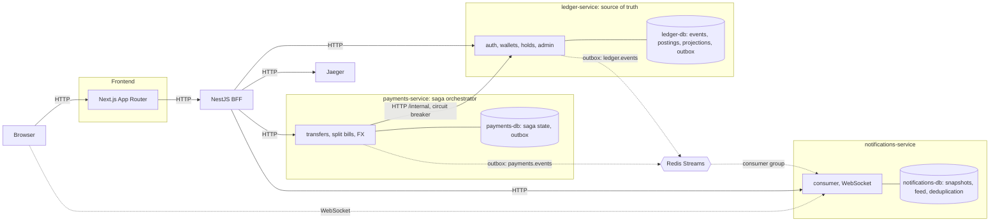

# P2P Ledger

A payments platform with multi-currency wallets, peer-to-peer transfers and split
bills. The event log is immutable, and any balance can be rebuilt from it from
scratch. The project is built on top of the provided starter repository.

- [Running the project](#running-the-project)
- [Architecture](#architecture)
- [Starter code](#starter-code)
- [Problems found](#problems-found)
- [Design decisions](#design-decisions)
- [Consistency model](#consistency-model)
- [Transfer saga](#transfer-saga)
- [Event schema and versioning](#event-schema-and-versioning)
- [Idempotency](#idempotency)
- [Security](#security)
- [Server/Client Components boundary](#serverclient-components-boundary)
- [Observability](#observability)
- [Tests](#tests)
- [Load test results](#load-test-results)
- [Not done, or would do differently](#not-done-or-would-do-differently)

## Running the project

```bash
docker compose up --build
```

Docker Compose 2.24 or newer is required. A clean clone needs no configuration
files: the stack starts with local development values (prefixed `dev-only`).

All ports are published on `127.0.0.1` only.

| What | Address |
|---|---|
| Frontend | http://localhost:3000 |
| ledger-service | http://localhost:3001 (`/docs`, `/metrics`) |
| payments-service | http://localhost:3002 (`/docs`, `/metrics`) |
| notifications-service | http://localhost:3003 (`/docs`, `/metrics`, `/health`) |
| BFF | http://localhost:3004 (`/docs`, `/metrics`, `/health`) |
| Jaeger | http://localhost:16686 |
| Postgres | 5433 (ledger), 5434 (payments), 5435 (notifications) |
| Redis | 6379 |

Local admin account: `admin@ledger.local` / `dev-only-admin-password`.

### Configuration

`.env.example` files are templates only; Docker does not read them. Each value has
one home:

| What | Where | How to change it |
|---|---|---|
| Shared secrets, admin, DB passwords | root `.env` | `cp .env.example .env` |
| Limits, timeouts, FX rates | `apps/<service>/.env` | `cp apps/<service>/.env.example apps/<service>/.env` |
| Addresses inside Docker | `docker-compose.yml` | edit the compose file |

Values under `environment` in compose take priority over `apps/<service>/.env`, so
Docker secrets go in the root `.env` and addresses go in compose. DB passwords apply
only when a volume is first created, so changing one requires
`docker compose down -v`. The same goes for the admin password, because the admin is
created once.

To develop without Docker: copy `.env.example` to `.env` in each service, start the
dependencies (`docker compose up -d ledger-db payments-db notifications-db redis`)
and run `npm install && npm run start:dev` in the service you need (`npm run dev` for
the frontend).

## Architecture



Solid arrows are synchronous HTTP; dashed arrows are asynchronous events or
WebSocket. Each subgraph is a separate transaction boundary: a Postgres transaction
never spans two databases, and XA is not used. All four NestJS services also export
spans to Jaeger over OTLP; these arrows are left out of the diagram.

| Service | Responsible for | Does not |
|---|---|---|
| `ledger-service` | authentication, wallets, event store, postings, projections, holds, reconciliation | know about the saga or split bills |
| `payments-service` | transfer saga, limits and deny list, FX rates, split bills, reminders | change money directly, only through the ledger API |
| `notifications-service` | state snapshots, activity feed, WebSocket | make decisions about money, it only reads events |
| `bff` | single API for the frontend, dashboard aggregation, traces for the admin screen | have a database or domain logic |
| `frontend` | UI, session in an httpOnly cookie | call services directly, except for WebSocket |

FX is a module inside `payments-service`, not a separate service: it is an optional
bonus in the assignment, and its rates are static (`FX_RATES_PER_USD`) with a TTL
cache and a quote TTL. Cross rates and credits round down, so converting there and
back can never produce more than the starting amount. Rounding half-up would let a
user turn 0.21 UAH into 0.42 UAH through USD at the expense of the FX account, and
reconciliation could not see it because each currency still nets to zero.

## Starter code

| What | State | Why |
|---|---|---|
| Monorepo, compose, CI | extended | added services, Jaeger, an e2e job and multi-stage Dockerfiles. Ports are bound to `127.0.0.1` |
| `auth` in ledger-service | structure kept, hardened | added atomic refresh token rotation, logout, an admin account with a role guard, login rate limiting, email normalization and secret checks. The module was not rewritten |
| `wallets` in ledger-service | reworked | the naive balance CRUD was replaced with event sourcing and a projection |
| `payments-service` | controller and DTO skeleton built out | there was no business logic |
| `notifications-service` | written from scratch | it only had a health endpoint |
| Frontend: login, registration, wallets | approach kept, bugs fixed | the pages are still a Server Component plus a route handler for tokens |
| Frontend: transfers, split bills, admin, feed | written from scratch | the starter code did not have them |
| `synchronize: true` in TypeORM | kept | see [what I would do differently](#not-done-or-would-do-differently) |

### Breaking changes

All of these come from the event sourcing refactoring or from security fixes.

| Before | After | Why |
|---|---|---|
| `GET/POST /wallets/:id/...` accepted someone else's wallet | 404 for someone else's wallet | IDOR |
| `:id` could be any string, 500 on a non-UUID | 400 | validation |
| `amount` could be any positive number | at most two decimals, with a per-operation cap | money is stored in cents |
| no endpoint to create a wallet | `POST /wallets` with a currency, idempotent; a recipient's wallet opens automatically | multiple currencies, spec 4.2 |
| response had `balance` | added `held`, `blocked`, `version` | holds and blocking |
| wallets could not be blocked | operations on a blocked wallet give 423 | spec 6: a blocked recipient |
| `POST /transfers` was a stub | 202, `Idempotency-Key` required | spec 4.2 |
| `POST /auth/login` had no limit | 429 past the limit | spec 4.3 |
| API error messages were in Ukrainian | English | the UI is in English |

The `wallets.service.spec.ts` tests with a mocked repository were replaced with
integration tests of the same names (`wallets.int-spec.ts`, the
`starter WalletsService behaviour` block): the new implementation works through
transactions, and a mock cannot prove locking behaviour. `auth.service.spec.ts` only
gained new tests. In CI, `npm install` became `npm ci` and `npm run lint` became
`npm run lint:ci`, which does not rewrite files; no other step was removed.

## Problems found

| # | Problem | How it was found | Test that confirms it | How it was fixed |
|---|---|---|---|---|
| 1 | **Double spend.** `withdraw` read the balance, computed the new one and saved it without a lock, so concurrent requests passed the check against the same value. Concurrent deposits were lost the same way | review of `wallets.service.ts`, then concurrent requests | `wallets.int-spec.ts`: `never lets concurrent withdrawals spend more than the balance`, `does not lose concurrent deposits` | a `SELECT ... FOR UPDATE` row lock inside a transaction, a DB `CHECK`, later the event stream version |
| 2 | **IDOR.** `getOne`, `deposit` and `withdraw` did not receive `ownerId` and worked on any wallet | controller review | `wallets.int-spec.ts`, the `ownership (IDOR)` block | queries always use `id` and `ownerId`; someone else's wallet gives 404 |
| 3 | **Weak validation.** Amounts as floats with no precision limit, `:id` with no UUID check, balance compared through `Number` | DTO review | `wallets.int-spec.ts`, the `input validation` block | `IsMoneyAmount`, `ParseUUIDPipe`, whole cents in `bigint` |
| 4 | **A test that passed by accident.** `does not allow withdrawing...` called `withdraw(...).catch(...)` with no `await` and no check that an error happened, so it could not fail | test review | `wallets.int-spec.ts`: `does not allow withdrawing more than the current balance` | the test was rewritten: it expects 400 and an unchanged balance, and the unawaited `.catch` is gone |

The fixes were made in `Fix/wallets idor validation (#2)` and
`Fix/wallet double spend (#3)`. Mutation checks confirm that the tests for 1–4 really
catch the problem: each fix was removed in a separate worktree, and the matching test
went red.

## Design decisions

**Event store on Postgres.** An append-only `ledger_events` table with a unique
`(streamId, streamVersion)`. The event, postings, projection and outbox row are
written in one transaction, so there are no intermediate states. EventStoreDB could
not give this guarantee without a separate delivery scheme, and it would add another
system to run. A trigger enforces immutability (`append-only.guard.ts`).

**Redis Streams as the broker.** It provides consumer groups, acknowledgements,
redelivery through `XPENDING`/`XCLAIM` and ordering within a stream, and the project
already needs Redis. Kafka would give long retention and partitioning, but this
domain has one consumer and a small load, so its cost does not pay off. Delivery is
at-least-once: the consumer drops duplicates by `eventId`.

**Orchestrated saga.** A transfer has a strict step order, compensation and a
deadline, and the client sees the status of each step. One coordinator with explicit
state in the `transfers` table is easier to verify and debug than a chain of
reactions to events. Choreography would spread the logic across services, and the
ledger would have to know about transfer steps.

**NestJS BFF rather than GraphQL.** The frontend needs a few aggregations and a
proxy, not arbitrary queries. A BFF gives the same stack, Swagger and graceful
dashboard degradation (`status: unavailable` per section) without a schema and
resolvers.

**Transactional outbox.** An event cannot be lost between the DB write and publishing
to Redis: it is written in the same transaction, and a separate relay publishes it
under an advisory lock, preserving order.

## Consistency model

| Invariant | Guarantee | Mechanism |
|---|---|---|
| Postings of an operation sum to 0 | synchronous | `assertBalanced` before writing, same transaction |
| Balance ≥ 0, `held ≤ balance` | synchronous | row lock and a DB `CHECK` |
| Projection matches events | synchronous | one transaction, stream version |
| An event is not lost | synchronous + at-least-once | outbox in the transaction, then republishing |
| A transfer is not created twice | synchronous | unique `(senderId, idempotencyKey)` |
| Funds are in the wallet, on hold, or credited | eventual across services | saga with compensation |
| Debit and credit | synchronous | capture writes both sides in one ledger transaction |
| Daily limit | synchronous within payments | advisory lock per sender |
| Split bill status | synchronous within payments | the transaction that applies the saga step |
| Live balance and feed | eventual | Redis Streams + projection in notifications |
| Admin reconciliation | as of a snapshot | `REPEATABLE READ`, read-only |

Strong consistency is needed where a mistake costs money, and a single database
provides it there. Across services it is impossible without XA, so consistency is
eventual: the saga has a deadline, after which it compensates. A delay in
notifications does not affect money, because notifications decides nothing. The
frontend compares wallet versions and transfer update times, so an older live state
never overrides fresher server data.

## Transfer saga

```
pending → checked → funds_held → confirmed → completed
              ↓          ↓           ↓
                     compensating → failed
```

A failure in `check` goes straight to `failed`, because no money is on hold. Anything
later, including a rejected hold, goes through `compensating`.

The worker claims due steps with `FOR UPDATE SKIP LOCKED`, sets a lease and applies
the result with an optimistic `version` check. If a worker crashes, another picks the
step up when the lease expires. All hold operations in the ledger are idempotent by
`holdId`.

### Compensation per step

| Step | What it does | If it fails | What is rolled back |
|---|---|---|---|
| `check` | wallets, deny list, rate, limits, daily limit reservation | `failed` | nothing: money was not touched. The limit reservation clears automatically because `failed` transfers are not counted |
| `hold` | `HoldPlaced` under the transfer id | `compensating` | an earlier attempt may still be in flight, even after a worker crash, so `release` writes a `voided` tombstone and a late hold gets 409 |
| `confirm` | rate freshness for a conversion, recipient state | `compensating` | `HoldReleased`, funds are available again |
| `capture` | `TransferCompleted` + `TransferReceived` in one transaction | `compensating` | `HoldReleased`. If the ledger answers 409 "already captured", the capture actually went through and the transfer becomes `completed` |
| `compensate` | releases the hold | retries with no attempt limit, with capped backoff, and ignores the deadline | money must not stay on hold. 404 means there is nothing to release |
| notification | event from the outbox | redelivery | not a saga step: the money has already moved |

### Stuck sagas

- `LEDGER_TIMEOUT_MS` (3 s) limits each ledger call. `SAGA_TIMEOUT_MS` (120 s) is the
  deadline for the whole transfer. After it, a
  `pending` transfer becomes `failed` and the rest go to compensation with the reason
  `timed_out`.
- While the ledger is unavailable (timeout, connection error, 5xx, open circuit
  breaker), steps retry until the deadline rather than up to the attempt limit: this
  is an outage, not a step failure. The status keeps `awaitingRetry: true`, and the
  request is not lost (spec 4.3).
- Other errors are bounded by `SAGA_MAX_STEP_ATTEMPTS` (5), including a refused
  `INTERNAL_API_KEY`: that is a configuration error, so waiting for it to pass is
  pointless.
- Covered by `saga-resilience.int-spec.ts`: `marks the transfer as awaiting a retry and
  finishes it once the ledger is back`.

## Event schema and versioning

Every event has `type`, `schemaVersion`, `streamVersion`, `eventId`, `payload` and
`metadata`. An event in the log never changes.

- **Reading old events.** `upcasters.ts` holds a chain of `Type@version`
  transformations. An event is raised to the current version before it is applied.
  For example, `MoneyDeposited@1` had no `currency` in its postings, and the upcaster
  adds it. The admin log shows the payload in the current schema and keeps the
  original `schemaVersion`.
- **A new version.** Add an upcaster and bump `CURRENT_SCHEMA_VERSION`. Without an
  upcaster, a projection rebuild fails explicitly instead of computing a wrong result.
- **Consumers.** `notifications-service` accepts the versions it knows and sends a
  newer event to the DLQ instead of reading it blindly.

`TransferInitiated` and `TransferFailed` from the list in spec 4.1 live in the
`payments.events` stream, not in the ledger. This is a deliberate deviation: these
facts describe saga state, not money. The ledger log holds what changes a balance:
`HoldPlaced`, `HoldReleased`, `TransferCompleted`, `TransferReceived`. A transfer that
failed before the hold never touched the ledger, so an event about it there would be
noise.

`ProjectionRebuilt` records every admin rebuild in the log: who did it and why. It
does not change the balance, but it raises the stream version, so notifications
refreshes its snapshot.

## Idempotency

| Where | Mechanism |
|---|---|
| `POST /transfers`, share payment | required `Idempotency-Key`, unique index, request hash |
| Deposit, withdrawal, split bill creation | optional `Idempotency-Key` with the same semantics |
| Saga steps | `holdId` = transfer id, repeated capture and release are safe |
| Event consumer | `eventId` inserted into `processed_events` in the same transaction as the effects |
| Notifications projections | an older `streamVersion` does not overwrite a newer one |

A repeat with the same key gives 200 and `Idempotent-Replayed: true`; a new request
gives 201 or 202. The same key on a different request gives 422. A key belongs to one
user. The key is optional on deposit and withdrawal so the existing API keeps working.

A transfer goes through the API with a client key, so the browser controls retries.
Server Actions derive the key from a hash of the form fields plus a `formId` that the
server generates on each render: resubmitting the same form gives the same key, while
a changed amount or a new render after success gives a new one.

## Security

- JWT access + refresh; the refresh token is stored hashed and rotated atomically.
- Tokens are stored in httpOnly cookies with `SameSite=Lax`. The one exception is
  `/api/ws-token`, which gives the access token to page JavaScript to open the
  WebSocket. Server Actions check the Origin, and logout rejects a foreign Origin.
- Ownership is checked on every wallet, transfer and bill request.
- `/internal` is protected by `INTERNAL_API_KEY`, `/admin` by role.
- Login rate limits: 5 attempts per client + email pair and 30 per client per minute.
  The first stops password guessing without letting anyone lock an account for
  everyone; the second holds back trying one password across many accounts.
- Transfers and share payments are rate limited per user.
- A client cannot choose the address these limits use. Next.js keeps a client's
  `X-Forwarded-For`, so `apps/frontend/server.js` replaces it with the socket address.
  The BFF and ledger accept the header only with a valid `X-Proxy-Secret`
  (`PROXY_SECRET`) and from an address `TRUST_PROXY` allows. Without the secret they
  drop the header, including on their directly published ports.
- Default values are meant for local development, so all ports are bound to
  `127.0.0.1`. The service and frontend containers run as the `node` user.

## Server/Client Components boundary

The rule: **Server Component by default; a Client Component only where browser
capabilities are needed**: WebSocket, form state, retry control.

| Where | What | Why |
|---|---|---|
| Pages | Server Component | first load from the BFF, the token stays on the server |
| `LiveWallets`, `LiveTransfers`, `ActivityFeed`, `SagaProgress` | Client | receive SSR data as `initial`, then update over WebSocket |
| `RealtimeProvider` | Client | one connection per app, a snapshot after reconnecting |
| `TransferForm`, `PayShare` | Client + API route | the client controls `Idempotency-Key` and retries |
| `OpenWalletForm`, `DepositForm`, `SplitBillForm` | Client form + Server Action | these mutations do not need real time |
| Heavy dashboard, activity and admin sections | `Suspense` | streaming, a slow section does not block the rest |

The existing login and wallet pages kept their approach: a Server Component for data
and a route handler to set the httpOnly cookie. `/api/ws-token` issues the WebSocket
token, because the cookie is not readable from the browser.

## Observability

- **Tracing.** OpenTelemetry across HTTP, the queue (traceparent in the event
  metadata) and the consumer. Jaeger: http://localhost:16686. The admin screen shows
  recent transfers and the time of each saga step.
- **Logs.** Structured JSON with `traceId`; responses carry `X-Trace-Id`.
- **Metrics.** `/metrics` in each NestJS service: HTTP, saga steps, breaker rejections,
  published outbox events, processed events.
- **Reconciliation.** `GET /admin/reconciliation` checks that debits and credits sum
  to zero for the period, that each operation balances, that projections match events,
  that balances match the sum of each account's postings, that held amounts match the
  holds table, and that no postings belong to an account with no event stream.
  `POST /admin/projections/rebuild` restores projections from the log. Problems a
  rebuild cannot fix are returned in `skipped`.

## Tests

```bash
cd apps/<service>
npm run lint:ci && npm run typecheck
npm test                     # unit, all except the frontend
npm run test:int             # integration: ledger, payments and notifications
```

Integration tests need Postgres and Redis. They create a `<service>_test` database and
reset its schema. E2e and load tests run against a running stack on the default
ports:

```bash
docker compose -f docker-compose.yml -f e2e/docker-compose.e2e.yml up -d --build
cd e2e && npm ci && npm test && npm run load
```

For a stack on other ports, set `LEDGER_URL`, `PAYMENTS_URL`, `NOTIFICATIONS_URL`,
`BFF_URL`, `FRONTEND_URL`, `JAEGER_URL`, `LEDGER_DB_URL` and `PAYMENTS_DB_URL`. Two
tests connect to the databases directly, so the last two matter as well.

| Spec §6 requirement | Where |
|---|---|
| Balance projection from events | `ledger-service/test/wallet-projection.spec.ts`, `stream-check.spec.ts` |
| Debits = credits invariant | `ledger-events.spec.ts`, `ledger.int-spec.ts` |
| Compensation at every step | `payments-service/test/transfer-saga.spec.ts` |
| Transfer, including conversion | `e2e/test/transfers.e2e-spec.ts` |
| A step failing after the hold | same file: `releases the reserved funds when the recipient is blocked...` |
| Repeated and concurrent key | `payments-service/test/transfers.int-spec.ts`, `e2e/test/transfers.e2e-spec.ts` |
| Postings sum to 0 after random operations | `ledger.int-spec.ts`, `reconciliation.e2e-spec.ts` |
| Double spend under load | `e2e/load/double-spend.ts` |
| Starter code problems | `wallets.int-spec.ts`, see [the table](#problems-found) |

Key checks also went through mutation testing: the logic was broken on purpose to
confirm that the test really fails.

## Load test results

Scenario: 300 concurrent transfers of 10 USD from a 1000 USD wallet. Without race
protection, total debits would exceed the balance. Environment: Docker Desktop on
macOS, all services on one machine, transfer limits raised through
`e2e/docker-compose.e2e.yml`.

| Metric | Value |
|---|---|
| Concurrent transfers | 300 × 10 USD from a 1000 USD wallet |
| Completed / expected | 100 / 100 |
| Rejected | `insufficient_funds`: 200 |
| Sender balance / held | 0.00 / 0.00 |
| Recipient balance | 1000.00 of 1000.00 |
| Reconciliation | ok |
| Wall time | 5215 ms |
| Settled sagas per second | 57.5 |
| `POST /transfers` latency p50 / p95 / max | 743 / 1266 / 1312 ms |
| Saga latency p50 / p95 / max | 1592 / 2625 / 2697 ms |

There was no double spend, and no money disappeared or was duplicated.

## Not done, or would do differently

- **DB migrations.** `synchronize: true` from the starter code stays. That is
  acceptable for a test project: one `docker compose up` creates the schema. Production
  would use TypeORM migrations.
- **DLQ replay tool.** Events in `notifications.dead-letter` can only be inspected for
  now. The next step would be an admin replay command.
- **Stream trimming.** `XADD MAXLEN ~ 100000`: during a very long consumer outage, old
  unread events could be trimmed. Money is not affected, but a snapshot can stay stale
  until that wallet's next event.
- **Permanent rejection during compensation.** If release keeps being rejected with a
  4xx, the saga stays visibly in `compensating`. This is reachable only with corrupted
  data. An operator alert would be needed.
- **A load balancer in front of the frontend.** `server.js` uses the socket address,
  so behind a load balancer every client would share one address. Production would
  read the client address from that balancer instead.
- **Sessions.** One refresh token per user, with no detection of a stolen token being
  reused. Signing in on a second device ends the first session.
- **A separate `fx-service`** with a real rate source.
- **Frontend tests.** There are no component tests; the pure logic for merging live
  data and parsing participants is tested in `e2e/test/live-merge.e2e-spec.ts`.
- **Idempotency keys** are kept forever. Production would have a retention policy.
- **Health endpoints** on ledger and payments: compose waits for the container to
  start, not for the app to be ready.
- **The daily limit race** is checked probabilistically: the test does not catch it on
  every run.
